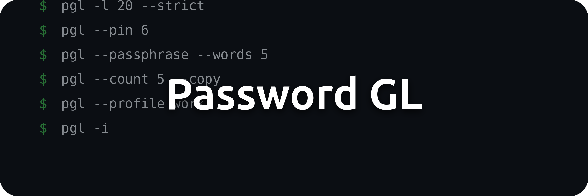

<div align="center">

<p align="center">
  
</p>

<p align="center"><b>English</b> | <a href="README.ja.md">日本語</a></p>

<h1 align="center">Password GL</h1>

<h3 align="center">Generate a secure password or passphrase with one command.</h3>

<p align="center">A CLI that generates passwords, passphrases, and PINs with Python's <code>secrets</code> module and shows the strength in bits. The commands are <code>password-gl</code> and <code>pgl</code>.</p>

<p align="center">
  <a href="https://pypi.org/project/password-gl/"></a>
  <a href="https://www.npmjs.com/package/@lapius/password-gl"></a>
  <a href="https://pepy.tech/projects/password-gl"></a>
  <a href="LICENSE"></a>
  <a href="https://www.python.org"></a>
  <a href="https://github.com/Lapius7/password-gl/stargazers"></a>
  <a href="https://github.com/Lapius7/password-gl/commits/main"></a>
</p>

<p align="center">
  <a href="#quick-start">Quick start</a> ·
  <a href="#options">Options</a> ·
  <a href="#examples">Examples</a> ·
  <a href="#development">Development</a>
</p>

</div>

---

## Features

- Cryptographically secure randomness (the `secrets` module).
- Strength shown as entropy in bits.
- Three modes: password, passphrase, and PIN.
- Save and load named profiles.
- Interactive mode (`-i`) walks you through every option.
- Japanese and English output.
- Auto-update when a new version is found.

## Quick start

You need Python 3.9 or later. The npm package also needs Node.js 18 or later (it uses the system Python).

**1. Install**

With pnpm (recommended):

```sh
pnpm add -g @lapius/password-gl
```

This gives you the `password-gl` command and the short name `pgl`. Run the same command to update. If you installed with npm, `pgl -u` also updates through npm.

> [!IMPORTANT]
> This package assumes **pnpm**. Installing with both npm and pnpm makes the same command appear twice, so use only `pnpm add -g`.

With pip:

```sh
pip install password-gl
```

Update with `pip install --upgrade password-gl` or `pgl -u`.

To use `--copy`, install pyperclip with either method:

```sh
pip install pyperclip
```

**2. Try it**

```sh
pgl                        # info screen
pgl -l 20 --strict         # 20 characters, every character type required
pgl --pin 6                # 6-digit PIN
pgl --passphrase --words 5 # 5-word passphrase
pgl --count 5 --copy       # generate 5 and copy the last one
pgl -i                     # interactive mode (guided setup)
```

Sample output (the values are examples; the labels follow your locale, or set them with `--lang ja|en`):

```
  🔑  K7#mPx@2qR!v
       強度  ████████░░  強い  72 bit

  🔑  1.  aB3$nQ9@wZ!r
       強度  ████████░░  強い  72 bit

  🔑  2.  mX4#pK7!vN2@
       強度  ████████░░  強い  72 bit
```

## Options

### Modes

| Option | What it does | Default |
|---|---|---|
| `-i, --interactive` | Interactive mode (guided setup) | - |
| `--pin <n>` | Generate a digits-only PIN | 4 |
| `--passphrase` | Generate a passphrase from a word list | - |

### Password settings

| Option | What it does | Default |
|---|---|---|
| `-l, --length <n>` | Number of characters | 12 |
| `--count <n>` | How many to generate | 1 |
| `--strict` | Always include every type (upper, lower, digit, symbol) | - |
| `--no-upper` | Do not use uppercase | - |
| `--no-lower` | Do not use lowercase | - |
| `--no-digits` | Do not use digits | - |
| `--no-symbols` | Do not use symbols | - |
| `--no-similar` | Exclude look-alike characters (`O 0 l 1 I \|`) | - |
| `--exclude-chars <s>` | Exclude the given characters | - |
| `--charset <s>` | Set the characters directly (overrides the other type flags) | - |
| `--starts-with <v>` | Constrain the first character (`lower` / `upper`) | - |
| `--prefix <s>` | String to add at the start | - |
| `--suffix <s>` | String to add at the end | - |
| `--separator <s>` | Separator | - |
| `--every <n>` | Insert the separator every N characters (use with `--separator`) | - |

### Passphrase settings

| Option | What it does | Default |
|---|---|---|
| `--words <n>` | Number of words | 4 |
| `--wordlist <path>` | Path to a word list file | built-in list |
| `--separator <s>` | Word separator | `-` |

### Output settings

| Option | What it does |
|---|---|
| `--copy` | Copy the last result to the clipboard |
| `--output-file <path>` | Save to a file |
| `--output-format <fmt>` | Output format (`text` / `json` / `csv`) |
| `--add-date` | Add the date (`YYYYMMDD`) as a prefix |
| `--add-user` | Add the user name as a prefix |

### Profiles

Save the settings you use often under a name and load them later.

```sh
pgl -l 20 --strict --no-similar --save-profile work   # save
pgl --profile work                                     # load
pgl --list-profiles                                    # list
```

Profiles are stored in `~/.pgl/profiles.json`.

### Other

| Option | What it does |
|---|---|
| `-u, --update` | Update to the latest version (through npm if installed with npm, through pip otherwise) |
| `--lang <ja\|en>` | Display language (also set by the `PGL_LANG` environment variable) |
| `-v, --version` | Show the version |
| `-h, --help` | Show help |

## Examples

```sh
# three 16-character passwords, no symbols, every type required
pgl -l 16 --no-symbols --strict --count 3

# separate with a hyphen every 4 characters
pgl -l 16 --separator - --every 4
# -> abcd-EFGH-1234-!@#$

# date and user name as a prefix
pgl --add-date --add-user -l 8

# 5-word passphrase, copied to the clipboard
pgl --passphrase --words 5 --copy

# save 10 passwords to a JSON file
pgl --count 10 --output-format json --output-file passwords.json

# save a profile and reuse it
pgl -l 24 --strict --no-similar --save-profile strong
pgl --profile strong --count 3
```

> [!NOTE]
> The options above were checked against the argument definitions in `password_gl/generator.py`. They were not run for this rewrite, and the clipboard, auto-update, and npm paths are unverified here.

## Development

Source: `password_gl/generator.py` (single module). Releases are published to PyPI (`.github/workflows/publish.yml`) and npm (`.github/workflows/npm.yml`) when a GitHub Release is published; npm uses Trusted Publisher, so no token is needed. The npm package in `npm/` bundles the Python source and runs it with the system Python.

**Author**: Lapius7 - [https://dev.lapius7.com](https://dev.lapius7.com) · X: [@Lapius7](https://x.com/Lapius7) · PyPI: [password-gl](https://pypi.org/project/password-gl/)

## License

MIT
